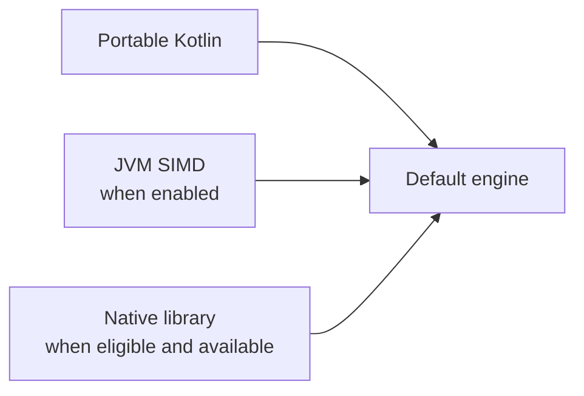

# Engines and native libraries

Use `koblas` normally. Every supported operation works without an installed native library, using
ordinary `DoubleArray` storage.

## How the default engine loads

The first use of `koblas` selects an engine once. It combines portable Kotlin with the accelerators
available under the platform rules below:

| Platform | Automatic selection |
|---|---|
| JDK 25+ | SIMD when enabled, otherwise portable Kotlin. Native access can add oneMKL on Intel or unidentified Linux x64. |
| Kotlin/Native, Intel or unidentified Linux x64 | First compatible library: oneMKL → AOCL → OpenBLAS |
| Kotlin/Native, AMD Linux x64 | First compatible library: AOCL → oneMKL → OpenBLAS |
| Kotlin/Native, Linux ARM64 | First compatible library: ArmPL → OpenBLAS |
| Kotlin/Native, macOS | System Accelerate |
| JDK 17–24, Android and iOS | Portable Kotlin; no native library lookup |

Missing libraries leave Kotlin available. Each call uses native code only when the operation and size
qualify; other work uses SIMD where possible, otherwise portable Kotlin. Library selection is not repeated.
Direct JVM bindings also support Accelerate, OpenBLAS, AOCL and ArmPL on their supported hosts;
automatic JVM native selection currently uses only oneMKL.

## Functions and native cutoffs

| Functions | JVM with SIMD enabled | Automatic JVM native use |
|---|---|---|
| DOT, SUM, NRM2, ASUM, IAMAX, AXPY | SIMD with scalar fallbacks | None |
| SCAL, COPY, SWAP, ROT | Kotlin loops and array-copy intrinsics | None |
| GEMV, SYMV, GER, SYR, SYR2, TRMV, TRSV | SIMD where applicable | None |
| GEMM, GEMMT, SYMM, SYRK, SYR2K, TRMM, TRSM | SIMD where applicable | Eligible oneMKL calls |
| Sparse vector and matrix BLAS | Kotlin traversal with SIMD arithmetic where applicable | None |

For automatic JVM oneMKL calls:

- The seven matrix-matrix routines require output rows, output columns and shared dimension or structured order each at least 128.
- Whole-matrix GEMM also qualifies with at least 16 output rows and columns and depth 1,024–4,096. Borrowed views keep the larger cutoff.

JVM native calls copy arrays; Kotlin/Native pins them and has separate cutoffs. Users do not configure
these thresholds. The retained Intel comparison measured oneMKL at 1.45–4.66x JVM SIMD throughput for
Level 3 cases at orders 128, 256 and 768, including transfers. See the
[per-function results and limitations](koblas-bench/lab/vendor-comparison.md#retained-onemkl-dispatch-comparison);
these results do not establish gains on other hosts.

## Setup

| Purpose on JDK 25+ | JVM argument |
|---|---|
| Enable SIMD | `--add-modules=jdk.incubator.vector` |
| Allow native calls on the classpath | `--enable-native-access=ALL-UNNAMED` |
| Allow native calls on the module path | `--enable-native-access=com.eignex.koblas` |

SIMD and native access are independent. Native use also needs a compatible LP64 library discoverable
by the system loader. Standard `~/intel/oneapi/mkl/latest` and `/opt/intel/oneapi/mkl/latest` locations
are searched for oneMKL. Configure flags and library locations before starting the application.

For an explicitly portable engine, use `KoblasEngine.portable()`. The manual loader `openBlas(vendor)`
means "open a BLAS binding"; it returns a binding for direct calls, or `null`, without changing `koblas`.
See the [API overview](koblas/module.md) for explicit engines and bindings, and the
[usage guide](USAGE.md) for array, workspace and view examples.
