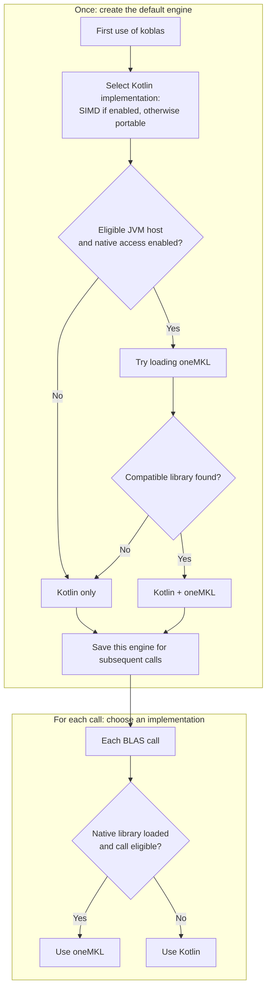

# Choosing an engine

Use `koblas` normally. It selects an engine automatically, and every supported operation works without
an installed native library. Your data stays in ordinary `DoubleArray` storage.

## How the default engine loads

The first use of `koblas` creates the default engine. That engine stays fixed for the lifetime of the
process. On the JVM, loading works like this:



SIMD requires JDK 25+ and `--add-modules=jdk.incubator.vector`. Without it, the JVM uses portable
Kotlin. Native loading is a separate option: the default tries oneMKL only on JDK 25+ Linux x64 with an
Intel CPU or an unidentified CPU vendor, and only when native access is enabled.

A missing or incompatible library leaves Kotlin in place. Loading oneMKL adds an option for eligible
matrix calls. Small calls, unsupported native entry points, vector operations and sparse operations
still use Kotlin. Call sizes affect this choice on each call; they do not trigger library loading again.

## What to enable on the JVM

For SIMD on JDK 25+, add this JVM argument:

```text
--add-modules=jdk.incubator.vector
```

For optional oneMKL on an eligible host, install an LP64 oneMKL runtime and make it discoverable by the
system library loader. Standard `~/intel/oneapi/mkl/latest` and `/opt/intel/oneapi/mkl/latest` locations
are also searched. Enable native access with the argument matching how you run the application:

| Application | JVM argument |
|---|---|
| Classpath | `--enable-native-access=ALL-UNNAMED` |
| Module path | `--enable-native-access=com.eignex.koblas` |

The two flags are independent: SIMD needs no native library, and oneMKL can be used without SIMD.
Configure flags and library locations before starting the application; the default engine does not rescan.

## Which calls can use oneMKL?

Kotlin implements all the functions below. Optional oneMKL changes execution only for eligible dense
matrix operations; installing it adds no new functions.

| Functions | With SIMD enabled | Automatic JVM native use |
|---|---|---|
| DOT, SUM, NRM2, ASUM, IAMAX, AXPY | SIMD, with scalar fallbacks | None |
| SCAL, COPY, SWAP, ROT | Kotlin loops and array-copy intrinsics | None |
| GEMV, SYMV, GER, SYR, SYR2, TRMV, TRSV | SIMD where applicable, with scalar fallbacks | None |
| GEMM, GEMMT, SYMM, SYRK, SYR2K, TRMM, TRSM | SIMD where applicable, with scalar fallbacks | oneMKL at the sizes below |
| Sparse vector and matrix BLAS | SIMD arithmetic where applicable; CSC traversal stays in Kotlin | No whole sparse call |

### Current selection thresholds

| Dense call | Size required for automatic oneMKL use |
|---|---|
| The seven dense matrix-matrix routines above | Output rows, output columns and shared dimension or structured order are each at least 128 |
| Additional GEMM cases | Output rows and columns are each at least 16, with shared dimension 1,024–4,096; applies to whole matrices, not borrowed views |

These are built-in choices; users do not configure thresholds. JVM native calls copy arrays into native
memory and copy results back, so a faster native kernel can still make a small call slower.

## How much does oneMKL help?

The retained Intel comparison measured the default engine using oneMKL against the exact JVM SIMD
engine at matrix orders 128, 256 and 768. The ranges below span those three tested orders and include
JVM array transfers:

| Routine | Observed oneMKL speedup |
|---|---:|
| GEMM | 1.92–2.17x |
| GEMMT | 1.45–1.95x |
| SYMM | 1.77–2.60x |
| SYRK | 1.78–2.19x |
| SYR2K | 1.59–3.17x |
| TRMM | 2.89–4.34x |
| TRSM | 2.36–4.66x |

Selected deep GEMM cases measured 1.29–2.13x with reused workspace. Other shapes and hosts can differ;
Level 2 and sparse performance gaps have not been established systematically. The
[measurement report](koblas-bench/lab/vendor-comparison.md#retained-onemkl-dispatch-comparison)
contains the exact cases, hardware and limitations, including the
[deep-GEMM comparison](koblas-bench/lab/vendor-comparison.md#thin-gemm-crossover).

## Other platforms

| Platform | What the default loads |
|---|---|
| JDK 17–24, Android and iOS | Portable Kotlin; no native library lookup |
| JDK 25+ on other JVM hosts | SIMD when enabled, otherwise portable Kotlin; no automatic native library lookup |
| Kotlin/Native on Intel Linux x64 | First compatible library: oneMKL, AOCL, then OpenBLAS |
| Kotlin/Native on AMD Linux x64 | First compatible library: AOCL, oneMKL, then OpenBLAS |
| Kotlin/Native on Linux ARM64 | First compatible library: ArmPL, then OpenBLAS |
| Kotlin/Native on macOS | System Accelerate |

Kotlin/Native also selects once and falls back to portable Kotlin if no compatible library loads. Its
native calls pin arrays rather than making JVM-style copies, so it has separate size thresholds.
Unidentified Linux x64 CPUs use the Intel preference order. LAPACK factorizations and banded or
packed-triangle BLAS interfaces are outside the API.

## Selecting or inspecting an engine explicitly

| API | Effect |
|---|---|
| `koblas` | Uses the fixed platform default, including eligible native calls |
| `KoblasEngine.portable()` | Creates an independent portable engine; loads no native library |
| `BuiltinEngines.simd` | Returns the exact JVM SIMD engine, or `null` when unavailable; loads no native library |
| `openBlas(Vendor.OneMkl)` | Opens a binding for direct calls, or returns `null`; does not install it into the default engine |

Call an explicitly selected engine directly; container conveniences continue using `koblas`.
`koblas.name` reports the selected kernels and `koblas.vendor` the attached native binding, if any.
Use `routeOf` to inspect a particular call: an attached library does not mean that call uses it.
