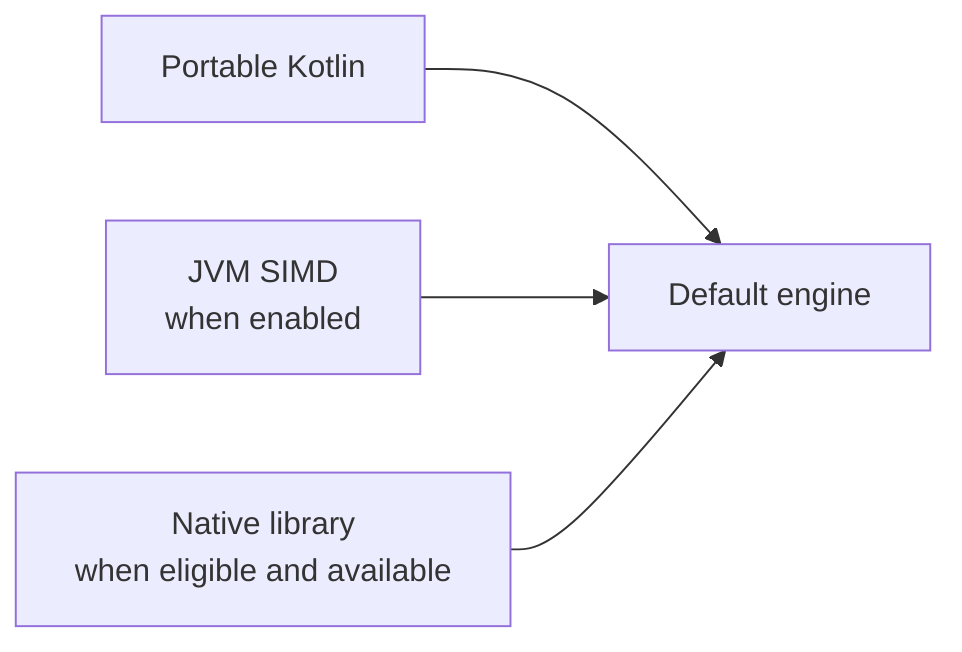

# Engines and native libraries

You can use every supported operation without installing a native library. Koblas works with ordinary
Kotlin double arrays and chooses an implementation for you. On the JVM, enabling SIMD is the first step
for faster vector and matrix arithmetic. A native library can help with larger matrix operations.

An engine is the implementation that carries out your calculations. Operators such as `a * b` and
convenience functions use the default engine, available as `koblas`.

## How the default engine loads

The first use of `koblas` selects the engine once, using what is available on your platform:



| Platform | What the default engine uses |
|---|---|
| JDK 25+ | JVM SIMD when enabled, otherwise portable Kotlin. Native access can add oneMKL on Intel or unidentified Linux/Windows x64. |
| Kotlin/Native, Intel or unidentified Linux/Windows x64 | First available compatible library: oneMKL → AOCL → OpenBLAS |
| Kotlin/Native, AMD Linux/Windows x64 | First available compatible library: AOCL → oneMKL → OpenBLAS |
| Kotlin/Native, Linux ARM64 | First available compatible library: ArmPL → OpenBLAS |
| Kotlin/Native, macOS | System Accelerate |
| JDK 17–24, Android and iOS | Portable Kotlin; no native library lookup |

Finding a library makes it available to the engine. Each calculation then uses it only if that operation
and size qualify; the rest uses JVM SIMD where applicable, or portable Kotlin. Missing libraries leave
the Kotlin implementation available. The engine does not search again for each call.

On JDK 25+, enable SIMD with this JVM argument:

```text
--add-modules=jdk.incubator.vector
```

SIMD processes several numbers in one CPU instruction. It requires no native numerical library and
works independently of native access.

On x86-64, vector-heavy workloads can also add `-XX:ObjectAlignmentInBytes=32`. HotSpot then starts
every array at a known offset, so dot products, absolute sums and maximum-magnitude searches can align
their loads. On Intel AVX-512 lab hosts, with both settings on the same machine
([10006](https://lab.eignex.com/jobs/10006), [10007](https://lab.eignex.com/jobs/10007)), dot products
of 4,096 elements and longer ran 13–19% faster, and norms and AXPY of 4,096 to 16,384 elements 21–28%
faster, and absolute sums 4–16% faster. AXPY of 65,536 elements ran 3–11% slower. Scaling, swaps,
rotations and vectors shorter than 4,096 elements changed by a few percent either way. The cost is memory:
every object is padded to 32 bytes.

## When a native library helps

On the JVM, vector operations and matrix-vector operations stay in Kotlin. SIMD covers dot products,
sums, norms, absolute sums, maximum-magnitude searches and scaled vector addition (AXPY), with scalar
fallbacks. Scaling, copying, swapping and rotations use Kotlin loops or array-copy intrinsics.
Matrix-vector products and rank updates use SIMD where applicable. Sparse operations keep their Kotlin
traversal and can use SIMD for the arithmetic within it.

Automatic JVM native calls are limited to larger matrix-matrix operations: GEMM, GEMMT, SYMM, SYRK,
SYR2K, TRMM and TRSM. Their output dimensions and shared dimension or structured order must each be
at least 64, or at least 128 for GEMMT and for borrowed views. Whole-matrix GEMM also qualifies with at
least 16 output rows and columns and a shared dimension of 1,024–4,096. These thresholds are built in.

JVM native calls copy arrays to and from native memory. An Intel comparison that includes this
cost measured oneMKL at 1.45–4.66x JVM SIMD throughput for matrix-matrix cases at orders 128, 256
and 768. For those workloads, installing oneMKL can pay off. For vector and matrix-vector workloads,
enabling SIMD is enough to reach the default engine's accelerated paths. These figures come from Intel
hosts; measure before relying on them elsewhere. Kotlin/Native can pin arrays in place and uses
separate native cutoffs.

To allow native calls on JDK 25+, also pass `--enable-native-access=ALL-UNNAMED` on the classpath,
or `--enable-native-access=com.eignex.koblas` on the module path. Install a compatible library using 32-bit BLAS
indices (LP64) and make it discoverable by the system loader. Koblas also searches `~/intel/oneapi/mkl/latest` and
`/opt/intel/oneapi/mkl/latest` for oneMKL on Linux. Set flags and library locations before starting the application.

On Windows, put matching vendor DLLs in an absolute directory on PATH, with runtime dependencies beside
the DLL or in Windows system directories. Windows shares Linux's vendor preferences and cutoffs, but
runtime behavior and thresholds have not been verified on a Windows host. Windows Arm64 supports
explicit JVM bindings; the Kotlin/Native target is Windows x64.

Direct JVM bindings also support Accelerate, OpenBLAS, AOCL and ArmPL on their supported hosts;
automatic JVM selection currently uses only oneMKL. The manual loader `openBlas(vendor)` means
"open a BLAS binding": it returns a binding for direct calls, or null, without changing the default engine.
To choose portable Kotlin explicitly, create a `KoblasEngine.portable()` and call it directly.
See the [API overview](koblas/module.md) for explicit engines and bindings, or the
[usage guide](USAGE.md) for array, workspace and view examples.
